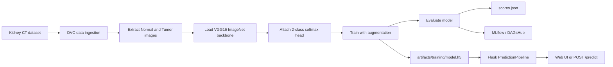
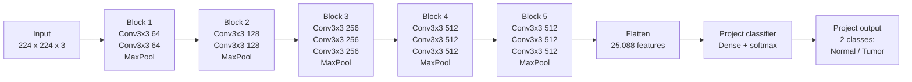
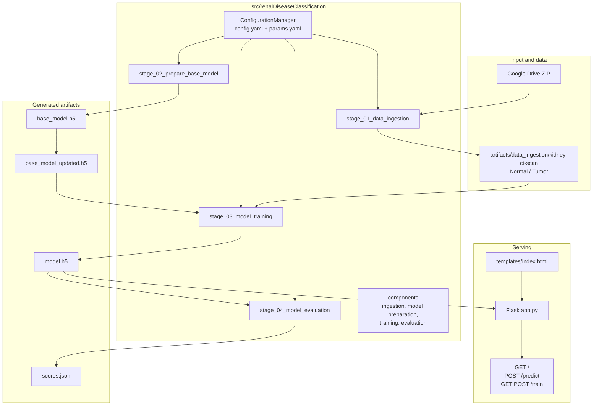

<div align="center">

# Renal Neoplasm Detection

### VGG16-based kidney CT scan classification with DVC, MLflow, and a Flask web app

<p>
  <a href="https://github.com/richochetclementine1315/Renal-Disease-Classification/stargazers">
    
  </a>
  <a href="https://github.com/richochetclementine1315/Renal-Disease-Classification/network/members">
    
  </a>
  <a href="https://github.com/richochetclementine1315/Renal-Disease-Classification">
    
  </a>
</p>
<p>
  
  
  
  
</p>

</div>

> **Important:** This project is an educational and research prototype. It is not a medical device and must not be used to make clinical decisions without appropriate medical validation and expert oversight.

## Table of contents

- [Overview](#overview)
- [Highlights](#highlights)
- [How it works](#how-it-works)
- [Model architecture](#model-architecture)
- [Repository structure](#repository-structure)
- [Prerequisites](#prerequisites)
- [Installation](#installation)
- [Run the complete pipeline](#run-the-complete-pipeline)
- [Launch the interactive application](#launch-the-interactive-application)
- [Use the prediction API](#use-the-prediction-api)
- [Configuration](#configuration)
- [Experiment tracking](#experiment-tracking)
- [Outputs](#outputs)
- [Troubleshooting](#troubleshooting)
- [Development workflow](#development-workflow)
- [Limitations](#limitations)
- [Contributing](#contributing)

## Overview

**Renal Disease Classification** classifies kidney CT scan images into two categories:

- `Normal`
- `Tumor`

The training system uses transfer learning with an ImageNet-pretrained VGG16 convolutional base. The original VGG16 classifier is excluded (`include_top: false`), a two-class softmax head is attached, and the resulting model is trained on the project dataset. Images are resized to `224 × 224` pixels and passed through VGG16 preprocessing.

The repository includes:

- A four-stage training and evaluation pipeline.
- DVC stage definitions for reproducible data and model generation.
- MLflow logging configured for the project's DAGsHub tracking URI.
- A Flask web interface for uploading an image and viewing a prediction.
- JSON and HTTP interfaces for integrating predictions into another client.
- Research notebooks corresponding to each pipeline stage.

## Highlights

| Capability | Implementation |
| --- | --- |
| Image backbone | `tf.keras.applications.VGG16` with ImageNet weights |
| Input | RGB image resized to `224 × 224` |
| Classes | `Normal`, `Tumor` |
| Augmentation | Rotation, flips, shifts, shear, and zoom |
| Training | Keras `ImageDataGenerator` with an 80/20 train-validation split |
| Evaluation | Keras metrics saved to `scores.json` |
| Reproducibility | DVC pipeline in [`dvc.yaml`](./dvc.yaml) |
| Tracking | MLflow, configured for DAGsHub |
| Application | Flask UI and `/predict` JSON endpoint |

## How it works



The reproducible stages are:

1. **Data ingestion** — downloads the dataset archive from Google Drive and extracts it.
2. **Prepare base model** — creates VGG16 without its original top classifier and saves the prepared model.
3. **Training** — creates augmented directory generators, trains for the configured number of epochs, and saves `model.h5`.
4. **Evaluation** — evaluates the trained model, writes `scores.json`, and logs parameters, metrics, and the model to MLflow.

## Model architecture

### VGG16 reference architecture

The following Mermaid diagram represents the VGG16 architecture supplied with this project: five convolutional blocks, max pooling after each block, and a classifier head. This project uses the convolutional feature extractor and replaces the original 1,000-class ImageNet head with a two-class softmax classifier.




In the original VGG16 configuration, the flattened feature vector is followed by dense layers of 4,096 and 4,096 units and a 1,000-class ImageNet softmax. In this repository, `INCLUDE_TOP: False` removes that original classifier and the project adds a two-unit softmax layer.

### Project architecture



## Repository structure

```text
Renal-Disease-Classification/
├── app.py                         # Flask web server and prediction routes
├── main.py                        # Runs all four pipeline stages sequentially
├── dvc.yaml                       # Reproducible DVC stage graph
├── dvc.lock                       # Locked DVC stage metadata
├── params.yaml                    # Training and model hyperparameters
├── config/config.yaml             # Dataset and artifact paths
├── requirements.txt               # pip dependencies
├── pyproject.toml                 # Project metadata and Python requirement
├── setup.py                       # Package installation metadata
├── artifacts/                     # Downloaded data and generated models
├── research/                      # Stage-by-stage Jupyter notebooks
├── src/renalDiseaseClassification/
│   ├── components/                # Ingestion, preparation, training, evaluation
│   ├── config/                    # ConfigurationManager
│   ├── entity/                    # Typed configuration dataclasses
│   ├── pipeline/                  # Executable pipeline stages and prediction
│   └── utils/                     # YAML, JSON, logging, and image helpers
├── templates/index.html            # Browser UI
└── scores.json                    # Latest evaluation metrics
```

Generated directories such as `artifacts/`, `logs/`, and `mlruns/` may be populated locally while running the project. Avoid committing large model files or downloaded datasets unless your storage policy explicitly supports them.

## Prerequisites

- Python **3.10 or newer**.
- Git.
- A working internet connection for dependency installation, VGG16 ImageNet weights, and the dataset download.
- Enough disk space for TensorFlow, the dataset, and generated Keras models.
- Optional: a GPU-enabled TensorFlow environment for faster training. The repository does not require a GPU.
- Optional: a DAGsHub account and credentials if you want to log to the configured remote MLflow server.

## Installation

### Windows PowerShell

```powershell
git clone https://github.com/richochetclementine1315/Renal-Disease-Classification.git
Set-Location .\Renal-Disease-Classification

py -3.10 -m venv .venv
.\.venv\Scripts\Activate.ps1

python -m pip install --upgrade pip
python -m pip install -r requirements.txt
```

If PowerShell prevents activation, either allow local scripts for your user with `Set-ExecutionPolicy -Scope CurrentUser RemoteSigned`, or run commands with the interpreter directly:

```powershell
.\.venv\Scripts\python.exe -m pip install -r requirements.txt
```

### macOS/Linux

```bash
git clone https://github.com/richochetclementine1315/Renal-Disease-Classification.git
cd Renal-Disease-Classification

python3 -m venv .venv
source .venv/bin/activate
python -m pip install --upgrade pip
python -m pip install -r requirements.txt
```

### Verify the environment

```powershell
python -c "import tensorflow as tf, flask, dvc, mlflow; print('TensorFlow:', tf.__version__); print('Environment OK')"
```

## Run the complete pipeline

### Recommended: DVC

From the repository root, run:

```powershell
.\.venv\Scripts\Activate.ps1
dvc repro
```

`dvc repro` runs only stages whose dependencies or parameters have changed. To force a complete rebuild:

```powershell
dvc repro --force
```

### Direct Python entry point

The sequential entry point is useful for debugging stage logs:

```powershell
python main.py
```

Individual stages can also be run directly:

```powershell
python -m src.renalDiseaseClassification.pipeline.stage_01_data_ingestion
python -m src.renalDiseaseClassification.pipeline.stage_02_prepare_base_model
python -m src.renalDiseaseClassification.pipeline.stage_03_model_training
python -m src.renalDiseaseClassification.pipeline.stage_04_model_evaluation
```

The first run downloads the dataset and VGG16 weights, so it can take longer than subsequent runs.

## Launch the interactive application

After a successful training run, start the Flask server:

```powershell
python app.py
```

Open <http://localhost:8080> in a browser. The interface lets you:

1. Select a kidney CT image.
2. Preview the selected image.
3. Submit the image for classification.
4. View the returned `Normal` or `Tumor` result.

The app loads the model from `artifacts/training/model.h5`. Run the training pipeline first if that file is missing.

> **Security note:** The `/train` endpoint invokes a local training command and is intended for trusted development use only. Do not expose this development server directly to the public internet.

## Use the prediction API

`POST /predict` accepts a JSON object with a base64-encoded image:

```powershell
$bytes = [System.IO.File]::ReadAllBytes(".\inputImage.jpg")
$image64 = [Convert]::ToBase64String($bytes)
$body = @{ image = $image64 } | ConvertTo-Json

Invoke-RestMethod `
  -Uri http://localhost:8080/predict `
  -Method Post `
  -ContentType "application/json" `
  -Body $body
```

Example response:

```json
[
  {
    "image": "Normal"
  }
]
```

Equivalent `curl` request:

```bash
IMAGE_BASE64=$(base64 -w 0 inputImage.jpg)
curl -X POST http://localhost:8080/predict \
  -H "Content-Type: application/json" \
  -d "{\"image\":\"${IMAGE_BASE64}\"}"
```

The additional routes are:

| Method | Route | Purpose |
| --- | --- | --- |
| `GET` | `/` | Serves the browser interface |
| `POST` or `GET` | `/train` | Runs `python main.py` locally |
| `POST` | `/predict` | Decodes and classifies a base64 image |

## Configuration

Change model and training behavior in [`params.yaml`](./params.yaml):

| Parameter | Current value | Meaning |
| --- | ---: | --- |
| `IMAGE_SIZE` | `[224, 224, 3]` | VGG16 input dimensions |
| `BATCH_SIZE` | `16` | Images per training batch |
| `EPOCHS` | `5` | Training epochs |
| `AUGMENTATION` | `True` | Enables image augmentation |
| `INCLUDE_TOP` | `False` | Removes the original VGG16 classifier |
| `CLASSES` | `2` | Normal and Tumor |
| `WEIGHTS` | `imagenet` | Pretrained VGG16 weights |
| `LEARNING_RATE` | `0.01` | SGD learning rate |

Dataset URLs and artifact locations are defined in [`config/config.yaml`](./config/config.yaml). The expected extracted dataset layout is:

```text
artifacts/data_ingestion/kidney-ct-scan/
├── Normal/
└── Tumor/
```

When parameters or pipeline dependencies change, rerun `dvc repro` so DVC records the updated result.

## Experiment tracking

The evaluation stage:

- Writes loss and accuracy to [`scores.json`](./scores.json).
- Logs configured parameters and evaluation metrics to MLflow.
- Registers the model as `VGG16Model` when a non-file MLflow tracking URI is used.

The current configuration points to the project's DAGsHub MLflow endpoint. If remote tracking requires authentication, configure credentials using the supported DAGsHub/MLflow mechanism in your environment; do not commit credentials to `secrets.txt`, source code, or configuration files.

For local inspection, MLflow artifacts may be created under `mlruns/`. A local MLflow UI can be started with:

```powershell
mlflow ui --backend-store-uri .\mlruns
```

Then open <http://127.0.0.1:5000>.

## Outputs

| Path | Description |
| --- | --- |
| `artifacts/data_ingestion/data.zip` | Downloaded dataset archive |
| `artifacts/data_ingestion/kidney-ct-scan/` | Extracted training data |
| `artifacts/prepare_base_model/base_model.h5` | VGG16 backbone |
| `artifacts/prepare_base_model/base_model_updated.h5` | Backbone with the project classifier |
| `artifacts/training/model.h5` | Trained classifier used by the app |
| `scores.json` | Latest evaluation loss and accuracy |
| `logs/running_logs.log` | Pipeline execution log |

## Troubleshooting

### `Trained model not found`

Run `dvc repro` or `python main.py` from the repository root. The web app expects `artifacts/training/model.h5`.

### Dataset download or extraction fails

Check internet access, confirm that the Google Drive file is available, and remove an incomplete `artifacts/data_ingestion/data.zip` before retrying.

### TensorFlow installation fails

Confirm that the selected interpreter is Python 3.10 or newer and that the virtual environment is active. On Windows, use the `python` executable inside `.venv` rather than a different global interpreter.

### DVC reports that a stage is not reproducible

Run `dvc status`, check that the repository root is the current directory, and inspect the stage command in [`dvc.yaml`](./dvc.yaml). Use `dvc repro --force` only when a clean rerun is intended.

### Predictions are unexpectedly poor

Review the dataset labels and class balance, inspect `scores.json`, verify that the input is a kidney CT image, and compare the preprocessing path with the training configuration. Model output should be treated as experimental until independently validated.

## Development workflow

1. Create or activate the virtual environment.
2. Update [`params.yaml`](./params.yaml) or source code.
3. Run the smallest affected stage while iterating.
4. Run `dvc repro` to validate the complete dependency graph.
5. Inspect `scores.json` and the generated logs.
6. Launch `python app.py` and test both the browser flow and `POST /predict`.
7. Keep large datasets, model binaries, credentials, and generated runtime files out of commits unless explicitly required.

The `research/` notebooks provide an exploratory view of the same major stages:

- `01_data_ingestion.ipynb`
- `02_prepare_base_model.ipynb`
- `03_model_training.ipynb`
- `04_model_evaluation_with_mlflow.ipynb`

## Limitations

- This repository currently implements a binary classifier, not a complete clinical diagnostic system.
- The default training configuration uses only five epochs and should not be interpreted as production-optimized.
- Evaluation and training use different generator preprocessing configurations in the current implementation; metrics should therefore be interpreted carefully and validated before use.
- The Flask server uses the built-in development server and has no authentication or production request hardening.
- Performance depends on dataset quality, class balance, image acquisition protocol, hardware, and reproducibility of the downloaded data.

## Contributing

Contributions are welcome. Before opening a pull request:

1. Explain the problem and the intended change.
2. Keep configuration, pipeline stages, and documentation synchronized.
3. Run the relevant pipeline stage and, where practical, `dvc repro`.
4. Include updated evaluation results for model or preprocessing changes.
5. Never include secrets, private patient data, or unlicensed datasets.

## License and attribution

No license file is currently included in this repository. Add an explicit license before distributing the project or its trained artifacts. VGG16 and ImageNet weights are provided through TensorFlow/Keras; review their respective terms before redistribution.

---

<div align="center">
  Built for reproducible medical-imaging research with TensorFlow, DVC, MLflow, and Flask.
</div>
